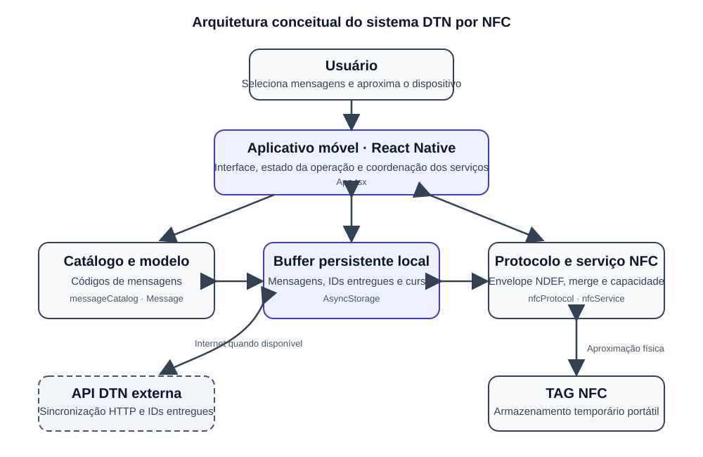

# 3 RESULTADO PRÁTICO: IMPLEMENTAÇÃO E AVALIAÇÃO DA ARQUITETURA DTN POR NFC

Este capítulo apresenta o resultado prático desenvolvido a partir do problema descrito na introdução: permitir que mensagens curtas sejam criadas e mantidas em um dispositivo mesmo quando não há conectividade contínua, e que possam ser transportadas por contatos físicos de proximidade até um ponto com acesso à rede. A solução materializa essa ideia em um aplicativo móvel com interface gráfica, buffer persistente, catálogo de mensagens, leitura e gravação de tags NFC e sincronização complementar com uma API.

O capítulo relaciona a arquitetura aos módulos do software, descreve o uso pela interface e delimita os resultados verificáveis. A presença de uma funcionalidade no código não equivale à sua validação experimental: alcance, latência, taxa de sucesso e capacidade útil da tag exigem ensaios em hardware real.

## 3.1 Visão geral e escopo do protótipo

O protótipo foi desenvolvido em React Native e TypeScript e combina transferência local por NFC com sincronização HTTP quando há rede. No contato, o dispositivo lê a tag, combina os dados com a fila local e tenta gravar o conjunto que couber em sua capacidade. A indisponibilidade temporária da API não impede a manutenção da fila nem a tentativa de transferência por tag.

Na implementação atual, o armazenamento persistente no telefone é realizado pelo AsyncStorage. Apesar do diretório se chamar `database`, esse mecanismo é um armazenamento local chave-valor e não um banco relacional. A API indicada no cliente é uma dependência externa: os arquivos analisados contêm as chamadas HTTP, mas não a implementação do servidor ou de seu banco de dados. Assim, os resultados deste capítulo dizem respeito ao aplicativo cliente e ao fluxo que ele implementa, não à disponibilidade, consistência ou desempenho de uma infraestrutura de servidor não incluída no projeto.

O protótipo implementa encaminhamento oportunista mediado por tag: combina mensagens, deduplica por identificador e remove itens entregues ou expirados. Embora o transporte físico se relacione ao conceito de mula de dados, o código não implementa descoberta automática de vizinhos, tabela de contatos ou roteamento epidêmico por rádio. Portanto, não valida um protocolo epidêmico geral.

## 3.2 Arquitetura conceitual do projeto

A Figura 1 resume os componentes e o fluxo: o usuário seleciona e cria mensagens; o aplicativo usa o catálogo e o buffer local e coordena NFC e HTTP. No contato, o serviço NFC interpreta e combina o envelope da tag. Com rede disponível, o cliente HTTP envia mensagens à API e atualiza o cache de IDs entregues.



**Figura 1 – Arquitetura conceitual do sistema proposto.** As setas bidirecionais indicam troca de dados; a API é uma dependência externa ao aplicativo. Fonte: elaboração própria com base na implementação.

Não se pressupõe conexão contínua entre origem e destino. A mensagem permanece local e pode ser copiada para uma tag; um dispositivo posterior pode incorporá-la à fila e, ao encontrar a API, encaminhá-la. A eficácia de uma cadeia de contatos ainda precisa ser avaliada com múltiplos aparelhos.

## 3.3 Interface de execução e experiência de uso

A execução é feita pela interface visual, sem comandos de console para criar mensagens ou transferi-las. A tela principal mostra o identificador do nó, estado NFC, contagens de mensagens pendentes e entregues, seletor do catálogo, buffer e controles de sincronização e limpeza.

Na inicialização, o aplicativo verifica o suporte NFC, carrega e limpa a fila e obtém o identificador persistido do nó. Sem NFC, a fila local continua disponível, enquanto a sincronização por tag fica desabilitada. No Android, o hardware foi declarado não obrigatório.

Para criar uma mensagem, a pessoa escolhe um código e aciona “Criar e Enfileirar Mensagem”. O aplicativo registra identificador, origem e horários, salva o objeto no AsyncStorage e atualiza o buffer. O catálogo contém oito itens: ajuda, água, pessoa ferida, alimentos, local seguro, evacuação, medicamentos e perigo identificado.

Para transferir, a pessoa aciona “Aproximar TAG e Sincronizar” e aproxima o celular de uma tag compatível. Durante a operação, o botão indica espera e bloqueia solicitações simultâneas. O resultado informa quantidades gravadas, entregues, expiradas ou não armazenadas, além de erros de NFC ou API. “Limpar” apaga apenas a fila local após confirmação.

Assim, a operação cotidiana ocorre pelos controles e mensagens da tela. Comandos eventualmente usados por desenvolvedores para compilar ou testar não fazem parte da interface do sistema.

## 3.4 Catálogo, estrutura de dados e buffer local

Em `src/constants/messageCatalog.ts`, cada código curto corresponde a uma descrição. O tipo `MessageCode` deriva das entradas cadastradas, e `getMessageLabel` fornece o rótulo exibido ou indica código desconhecido.

O modelo `Message`, em `src/types/Message.ts`, contém `id`, `originDevice`, `createdAt`, `expiresAt`, `code` e `deliveredAt`. Os tempos são números em milissegundos; a data de entrega opcional permite distinguir mensagens enfileiradas das entregues.

A função `createMessage`, em `src/utils/messageUtils.ts`, define validade de 24 horas e cria um identificador combinando horário e número pseudoaleatório. É suficiente para identificar e deduplicar no protótipo, mas não é um identificador criptográfico nem oferece garantia contra colisões em grande escala.

O armazenamento local utiliza chaves distintas para a fila de mensagens, o identificador do dispositivo, os IDs entregues e o cursor de consulta à API. Um trecho representativo da persistência é:

```ts
const MESSAGES_KEY = '@dtn:messages';

export async function saveMessages(
  messages: Message[]
): Promise<void> {
  await AsyncStorage.setItem(
    MESSAGES_KEY,
    JSON.stringify(messages)
  );
}
```

Na inicialização, `getMessages` carrega a fila e `removeExpiredMessages` compara `expiresAt` com o horário atual, salvando a lista se houve remoções. O prazo de 24 horas evita retenção indefinida, mas ainda precisa ser validado para o cenário: mensagens urgentes podem perder utilidade antes do prazo, enquanto desconexões longas podem exigir prazo maior. É uma decisão implementada, não um valor experimentalmente otimizado.

`mergeMessages` combina as fontes por `id`, conserva o estado de entrega conhecido, remove vencidas e ordena por criação. Isso reduz duplicatas em leituras repetidas. IDs entregues são armazenados separadamente para reconhecimento em operações posteriores; a atualização depende das respostas da API.

## 3.5 Protocolo de dados e operação da camada NFC

O módulo `src/nfc/nfcProtocol.ts` codifica a estrutura em um registro NDEF de texto. O envelope v3 inclui versão (`v`), ponto (`p`) e lista de mensagens (`m`); os campos internos são abreviados e os horários são convertidos para base 36 para reduzir o JSON.

```ts
const envelope = {
  v: 3,
  p: pointId,
  m: messages.map(message => ({
    i: message.id,
    o: message.originDevice,
    t: message.createdAt.toString(36),
    e: message.expiresAt.toString(36),
    c: message.code,
  })),
};
```

O decodificador procura o registro de texto, interpreta o JSON e reconstrói as mensagens. Aceita v2 (horários numéricos), v3 (base 36) e o formato legado `NFC_POINT`. Estrutura inválida ou versão desconhecida resulta em erro.

O serviço `src/nfc/nfcService.ts` lê os registros, identifica o ponto ou utiliza `PONTO-001`, remove vencidas e combina a fila local com os dados da tag. Para gravar, prioriza mensagens locais pendentes e testa o tamanho codificado contra a capacidade informada pela tag.

Se mensagens pendentes já existentes na tag não couberem, a gravação é cancelada para evitar apagá-las silenciosamente. Antes de escrever, o serviço confere se a tag ainda é a mesma lida no início e, ao final, libera a sessão NFC.

Uma tag passiva não precisa de bateria, mas o leitor requer NFC ativo e a tag deve ser gravável e compatível com NDEF. Não há emparelhamento entre nós nem medição de distância no código; a aproximação é uma condição operacional, não um alcance quantificado.

## 3.6 Sincronização oportunista e integração com a API

`synchronizeWithTag` remove itens vencidos e consulta o cache de IDs entregues. Primeiro tenta enviar mensagens locais pendentes à API; depois lê e combina os dados da tag e tenta encaminhar os itens recebidos. A API, portanto, complementa, mas não condiciona o armazenamento local ou a tentativa NFC.

Em `src/services/apiService.ts`, a rota de sincronização recebe identificador do dispositivo, mensagens e IDs conhecidos. Outra rota consulta IDs entregues por cursor (`after_id`) e persiste as páginas e o próximo cursor. A aplicação atualiza o cache na inicialização e ao voltar ao primeiro plano.

Falhas de rede são reportadas separadamente do resultado NFC. A tag pode ser atualizada sem entrega remota, ou mensagens locais podem ser enviadas antes da leitura da tag; por isso, o resultado deve ser interpretado por componente.

O cliente usa uma URL HTTP privada de rede local; a operação exige um servidor acessível com os endpoints e formatos esperados. Os arquivos não demonstram autenticação, criptografia de transporte, autorização nem banco remoto. Esses pontos e a configuração por ambiente precisam ser tratados antes de implantação.

## 3.7 Procedimento de execução e avaliação

O procedimento de demonstração começa pela tela: conferir NFC e identificador, criar uma mensagem e confirmar sua presença no buffer. Para avaliar persistência, reabre-se o aplicativo e verifica-se se o item não expirado continua listado. Isso não comprova a transferência por tag.

Em seguida, aproxima-se uma tag NDEF gravável e solicita-se sincronização. A tela apresenta contagens e erros. Em teste com dois aparelhos, o primeiro grava uma mensagem na tag e o segundo verifica se a incorpora à fila; com API disponível, conferem-se os IDs reconhecidos como entregues. Esse é um protocolo recomendado, não um ensaio que possa ser declarado realizado sem observação ou registro.

Para cada ensaio de desempenho, registrar aparelho, sistema operacional, tag, número e tamanho das mensagens, conectividade e resultado. Medir a latência de NFC separada da latência da API, calcular a taxa de sucesso com falhas categorizadas e informar a capacidade efetiva em bytes e mensagens. Esses valores variam com o hardware e o overhead NDEF.

Um quadro adequado para preenchimento após os ensaios é:

| Métrica | Método de coleta | Resultado experimental |
|---|---|---|
| Latência de leitura e gravação NFC | Cronometrar o início da aproximação e a apresentação do resultado; repetir e informar média, dispersão e número de tentativas. | A medir em aparelho e tag identificados. |
| Capacidade efetiva | Aumentar gradualmente o número de mensagens e registrar o maior envelope aceito sem erro. | A medir; depende da tag e do conteúdo. |
| Taxa de sucesso NFC | Dividir operações NFC concluídas pelo total de tentativas, registrando as condições de cada ensaio. | A medir com repetições. |
| Entrega à API | Comparar IDs enviados com IDs reconhecidos pela resposta e pelo cache local. | A medir com serviço compatível. |
| Persistência local | Fechar e reabrir o aplicativo e conferir as mensagens não expiradas. | Verificação funcional a executar em dispositivo. |

O quadro evita atribuir ao software valores não medidos e permite comparar API disponível, falta de rede e falha durante a sincronização, sem confundir gravação NFC com entrega remota.

## 3.8 Resultados observados e limitações

O código implementa oito tipos de mensagem, criação com origem e validade de 24 horas, persistência local, expiração, união por identificador, codificação NDEF v3 e leitura v2/legada, seleção limitada pela capacidade da tag, resumo de operação e chamadas HTTP com atualização paginada de IDs entregues.

Esses resultados foram verificados por inspeção do código. Não há relatórios de ensaios NFC, latência, taxa de sucesso, comparação de tags ou funcionamento da API externa. Portanto, a implementação não permite afirmar desempenho quantitativo ou validação em hardware específico.

Há um teste automatizado de renderização inicial, mas a execução da suíte foi interrompida porque o Jest tentou interpretar `global.css` como JavaScript. O teste não chegou a executar, portanto não há aprovação automatizada. Também não foram encontrados testes de NDEF, deduplicação, expiração, capacidade ou API. A falha de configuração não prova que a interface falhe no aparelho; a validação física continua necessária.

| Aspecto avaliado | Evidência disponível | Resultado que pode ser afirmado |
|---|---|---|
| Interface sem comandos para a pessoa usuária | Tela com catálogo, criação, buffer, estado NFC, sincronização e limpeza. | Fluxo visual implementado no código. |
| Buffer local | AsyncStorage, carregamento na inicialização e salvamento após criação/sincronização. | Persistência implementada; teste em dispositivo pendente. |
| Protocolo de mensagem | Encoder v3 e decoder para v2/v3 e formato legado de ponto. | Compatibilidade prevista no código; casos de teste automatizados pendentes. |
| Transferência com tag | Leitura NDEF, mesclagem, verificação de capacidade e gravação. | Fluxo implementado; validação física não documentada. |
| Integração remota | Cliente HTTP para sincronização e paginação de IDs. | Chamadas implementadas; serviço externo não validado nos arquivos examinados. |
| Teste automatizado de interface | A suíte interrompeu na importação de `global.css`. | Não executado; não há aprovação automatizada a reportar. |
| Latência, alcance, taxa de sucesso e capacidade real | Não há medições experimentais disponíveis. | Não determinados. |

A principal limitação é a falta de ensaios controlados. Para completar a avaliação, deve-se configurar o Jest para CSS, testar criação, expiração, merge e protocolo e executar testes repetidos com aparelhos e tags identificados. A API deve ser avaliada em servidor compatível, controlando os estados de conectividade.

O escopo também não inclui descoberta de contatos, roteamento sem fio ou demonstração de uma cadeia de múltiplas mulas. Usa um ponto padrão quando a tag não contém identificação e depende da circulação e leitura física da tag. Não foram identificadas medidas de confidencialidade ou autenticação ponta a ponta. Essas limitações restringem conclusões de segurança, escalabilidade e operação em campo.

## 3.9 Síntese dos resultados

O resultado prático é um aplicativo cuja interface permite criar e acompanhar mensagens sem comandos de console, combinando buffer persistente, transferência NFC e sincronização HTTP. A arquitetura separa catálogo, modelo, armazenamento, protocolo, serviço NFC e cliente de API.

O código prevê conservação local, expiração, deduplicação, compatibilidade de envelopes e verificação de capacidade. A avaliação permanece funcional e baseada na implementação: o teste automatizado não executou e não existem medições em hardware. Assim, o protótipo demonstra a arquitetura cliente, mas conclusões quantitativas dependem dos ensaios propostos.
